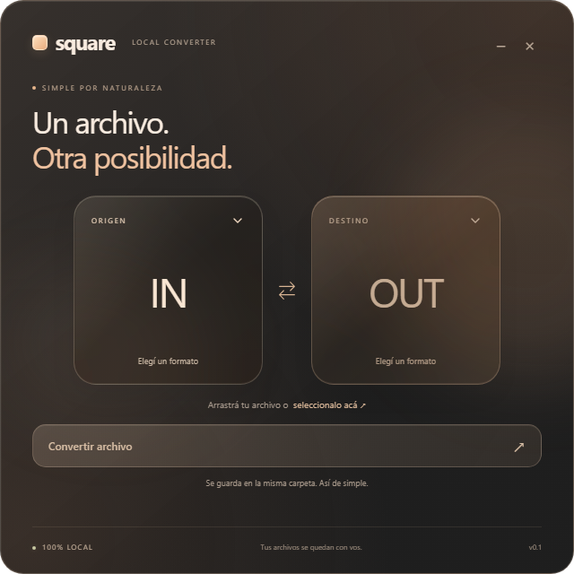

# Square

Convertidor local de archivos. Tauri 2 + Rust + React + Tailwind. Ventana cuadrada naranja/negra. Arrastrá un archivo, elegí destino y convertí. Resultados en el directorio original, nunca sobrescribiendo.

La interfaz usa naranja pálido y paneles de cristal con reflejos suaves. Ambos bloques tienen desplegables: origen abre un selector filtrado por el formato elegido; destino muestra las conversiones disponibles para el archivo detectado. También se puede arrastrar el archivo o seleccionarlo sin filtro. La vista principal muestra solo formato y tamaño, sin exponer nombres o rutas en mensajes de estado.

### Verificar la interfaz
Con `npm run dev` activo, ejecutar `npx playwright install chromium` una vez y después `npm run test:ui`. La prueba usa comandos y diálogos nativos simulados y verifica los menús, filtros, cancelación, Escape, clic exterior y ocultación del nombre. Las conversiones reales se verifican con las pruebas Rust.

## Desarrollo
Necesita Node 22, Rust estable, herramientas C++ de Windows y WebView2. En Linux: WebKitGTK 4.1, appindicator y librsvg. Preparar FFmpeg y Pandoc en PATH; ejecutar `scripts/prepare-engines.ps1` en Windows o `bash scripts/prepare-engines.sh` en Linux. Luego `npm ci` y `npm run tauri dev`.

## Compilar
- Windows: `npm run tauri build -- --bundles nsis`. Portable: `src-tauri/target/release/square.exe`. Instalador: `src-tauri/target/release/bundle/nsis/`.
- Linux: `npm run tauri build -- --bundles appimage` en Ubuntu 22.04 con dependencias. CI incluye FFmpeg estático; verificar códecs en la distribución objetivo. AppImage no garantiza todas las distribuciones Linux.
- Los motores están embebidos en el ejecutable; primera conversión los extrae en el directorio temporal. El portable Windows requiere WebView2 ya instalado; el instalador lo descarga si falta.

## Compatibilidad
Audio/video por FFmpeg, imágenes por image, documentos por Pandoc y PDF textual a TXT. La matriz completa y las limitaciones están en `.specify/spec.md`. No se ofrece XLSX, OCR ni PDF a DOCX; SVG usa resvg; HEIC depende del decoder de FFmpeg. Imágenes animadas se reducen a un cuadro. No hay cancelación durante una conversión; cerrar la aplicación interrumpe el trabajo de Rust pero puede dejar subprocesos hasta completar.

## Repositorio
Repositorio Git local. Para publicar: `gh auth login`, luego `gh repo create Square --private --source . --push`. CI compila Windows y Linux en cada push. Ningún archivo convertido se sube.

## Licencias
Código de Square: GPL-3.0-or-later. Esta distribución incorpora FFmpeg GPL y Pandoc GPL; las redistribuciones deben cumplir las licencias de los motores, conservar avisos e incluir o proporcionar el código fuente correspondiente a la compilación exacta. Consultar THIRD_PARTY.md. Artefactos locales de desarrollo sin firma digital.
