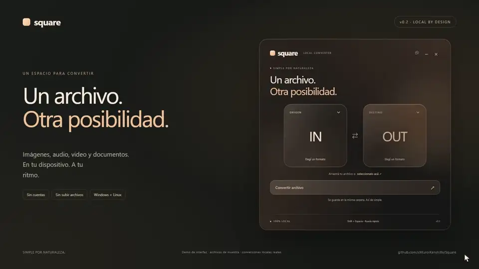

<p align="center"></p>
<h1 align="center">Square</h1>
<p align="center">Un archivo. Otra posibilidad.<br>Un convertidor local, pequeño en la pantalla y directo en lo que hace.<br>Imágenes, audio, video y documentos. Sin cuentas ni archivos en la nube.</p>
<p align="center"><a href="https://github.com/xXKuroiKenshiXx/Square/releases/tag/v0.2.0"><b>Descargar Square</b></a> · <a href="docs/demo.mp4"><b>Ver el video</b></a> · <a href="#rueda-rápida"><b>Shift + Espacio</b></a></p>
<p align="center"><a href="https://github.com/xXKuroiKenshiXx/Square/actions/workflows/build.yml"></a>  </p>
<p align="center"><a href="docs/demo.mp4"></a></p>
<p align="center"><sub><a href="docs/demo.mp4">Video promocional · 35 segundos</a> · Vistas reales de React con archivos de muestra y conversiones reales del motor Rust.<br>El selector de archivos y el enlace con la ventana se preparan para la grabación. No es un benchmark ni una grabación del Explorador. <a href="docs/MEDIA.md">Cómo se grabó</a>.</sub></p>

## Menos pasos

- **Dos bloques, un resultado.** Arrastrá un archivo, elegí su destino y convertí.
- **Una rueda junto al cursor.** En Windows seleccioná un archivo en el Explorador o el Escritorio y presioná **Shift + Espacio**.
- **Tu propio atajo.** Cambialo o desactivalo desde el engranaje de Configuración.
- **El original se conserva.** El resultado se guarda en la misma carpeta con un nombre nuevo.
- **Tus archivos se quedan con vos.** Las conversiones se procesan localmente; no hay cuentas ni telemetría.
- **Un espacio tranquilo.** Naranja pálido, cristal, bordes suaves y nombres de archivos ocultos en la vista principal.

## Descargar

Square **0.2 es una versión preliminar**. Binarios x64 sin firma digital. Los motores están incluidos en el ejecutable; por eso el portable es más grande que la interfaz.

| Sistema | Descarga | Uso |
| --- | --- | --- |
| Windows 10/11 x64 | [Portable](https://github.com/xXKuroiKenshiXx/Square/releases/download/v0.2.0/Square-0.2.0-portable.exe) | Abrir el `.exe`; necesita WebView2 instalado. |
| Windows 10/11 x64 | [Instalador NSIS](https://github.com/xXKuroiKenshiXx/Square/releases/download/v0.2.0/Square_0.2.0_x64-setup.exe) | Instala para tu usuario y puede descargar WebView2 si falta. |
| Linux x64 | [AppImage](https://github.com/xXKuroiKenshiXx/Square/releases/download/v0.2.0/Square_0.2.0_amd64.AppImage) | Dar permiso de ejecución y abrir. La release local tiene base Ubuntu 24.04. |
| Fuentes y verificación | [Release completa](https://github.com/xXKuroiKenshiXx/Square/releases/tag/v0.2.0) | Código, fuentes de los motores, versiones y SHA-256 junto a los binarios. |

```bash
chmod +x Square_0.2.0_amd64.AppImage
./Square_0.2.0_amd64.AppImage
# Si no tenés FUSE:
./Square_0.2.0_amd64.AppImage --appimage-extract-and-run
```

La apariencia transparente necesita un compositor. La compatibilidad de AppImage depende de las bibliotecas base de la distribución; no se garantiza cualquier Linux. El flujo de CI compila sobre Ubuntu 22.04.

## Rueda rápida

1. Abrí Square; podés dejarlo en la bandeja.
2. **Windows:** seleccioná **un archivo local** en el Explorador o el Escritorio.
3. Presioná **Shift + Espacio**. La rueda aparece junto al cursor y muestra solo destinos compatibles.
4. Elegí un formato. Square guarda el resultado junto al original. **Escape** o hacer clic fuera de la rueda la cierra.

Si hay más de ocho destinos, usá **Más formatos** en el centro. También podés abrir la rueda con el botón **Rueda** después de cargar un archivo en la ventana principal.

**Linux:** la rueda usa el archivo cargado en Square. La selección externa no es común a todos los gestores de archivos. Los atajos globales dependen del escritorio y pueden no estar disponibles en Wayland.

El engranaje permite capturar una combinación nueva con Ctrl, Alt o Shift. Si ya está ocupada, se conserva la anterior. La configuración se recuerda entre sesiones. Cerrar la ventana mantiene Square en la bandeja; elegí **Salir de Square** para terminarlo. No se instala inicio automático.

## Formatos

| Familia | Entrada | Destinos |
| --- | --- | --- |
| Imágenes | PNG, JPG/JPEG, WEBP, SVG, AVIF, BMP, TIFF, GIF, ICO, PNM, TGA, DDS, QOI; HEIC/HEIF según decoder | PNG, JPG, WEBP, BMP, TIFF, GIF, ICO |
| Audio | MP3, WAV, AAC, FLAC, OGG, WMA, M4A, OPUS, AIFF | Otros formatos de audio de la lista |
| Video | MP4, MKV, MOV, WEBM, AVI, MPEG, M4V, WMV, TS, FLV | Otros formatos de video y extracción de audio |
| Documentos | DOCX, Markdown, HTML, TXT, RST, ODT, RTF, EPUB, LaTeX | DOCX, MD, HTML, TXT, ODT, RTF, EPUB |
| PDF textual | PDF con texto extraíble | TXT |

### Límites de esta versión

- No incluye XLSX, OCR ni PDF → Word con conservación de diseño.
- SVG se rasteriza; no genera vectores a partir de una fotografía. GIF animado produce una imagen fija. JPEG descarta transparencia; ICO se limita a 256 píxeles.
- La compatibilidad de medios depende de los códecs incluidos en FFmpeg. HEIC puede no estar disponible en todas las compilaciones.
- TXT se interpreta como Markdown al convertir documentos. Las conversiones no prometen preservar todos los detalles de diseño.
- Una conversión simultánea; todavía no hay lote, porcentaje de progreso ni cancelación. Salir durante una conversión puede dejar un subproceso hasta que termine.

## Desarrollo

Node.js 22+, Rust estable con Cargo, FFmpeg y Pandoc. Windows requiere herramientas C++ de MSVC y WebView2. En Ubuntu:

```bash
sudo apt install build-essential curl pkg-config libwebkit2gtk-4.1-dev libayatana-appindicator3-dev librsvg2-dev patchelf
```

```bash
npm ci
# Windows (PowerShell):
./scripts/prepare-engines.ps1
# Linux:
bash scripts/prepare-engines.sh
npm run tauri dev
```

Los motores de `src-tauri/engines/` no se versionan. Se embeben al compilar y se extraen a una carpeta temporal al necesitarlos. Las preferencias van al directorio de configuración de la app.

### Compilar y verificar

```bash
npm run build
cargo test --manifest-path src-tauri/Cargo.toml --bin square
# Windows:
npm run tauri build -- --bundles nsis
# Linux:
npm run tauri build -- --bundles appimage
```

El portable sale en `src-tauri/target/release/square.exe`; los paquetes, en `src-tauri/target/release/bundle/`. Para las pruebas de interfaz, dejá `npm run dev` activo y ejecutá `npx playwright install chromium` y `npm run test:ui`. Los diálogos y comandos se simulan en esa prueba; Rust verifica las conversiones reales.

### Estructura

```text
src/                    React, menús, configuración y rueda SVG
src-tauri/src/main.rs    Motor de conversión y comandos de Tauri
src-tauri/src/quick.rs   Atajo, preferencias, bandeja y ventana flotante
src-tauri/src/selection.rs  Selección de Windows mediante Shell/COM
tests/                  Pruebas de interfaz
scripts/                Preparación, compilación, grabación y verificación
docs/                   Demo, capturas, licencias y guía de release
.specify/               Constitución, especificación y tareas
```

## Participar

[Reportar un problema](https://github.com/xXKuroiKenshiXx/Square/issues/new/choose) · [Proponer una mejora](https://github.com/xXKuroiKenshiXx/Square/issues/new/choose) · [Contribuir](CONTRIBUTING.md) · [Seguridad](SECURITY.md) · [Cambios](CHANGELOG.md).

## Licencia y créditos

[GPL-3.0-or-later](LICENSE). Square incluye FFmpeg GPL y Pandoc, que conservan sus licencias. Las versiones, fuentes y avisos están en [THIRD_PARTY.md](THIRD_PARTY.md) y [docs/ENGINE-SOURCES.md](docs/ENGINE-SOURCES.md).

La presentación toma como referencia la claridad de [Oval](https://github.com/xXKuroiKenshiXx/Oval). La interacción radial está inspirada en [Tangerine](https://tangerineformac.com/); el código y los recursos gráficos de Square son propios. No hay afiliación con Tangerine.
